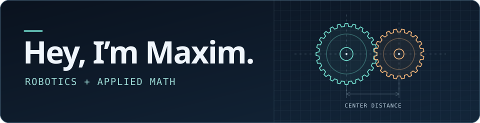

# 

Two gears on our FRC turret had clearance in CAD and still jammed. We measured the spacing between their centers, and it was right. The gears themselves were slightly bigger than the model. That’s the kind of problem I like: something should work, and figuring out why it doesn’t sends me looking at the one thing I took for granted.

## What I’m working on

**FRC Team 293** · I lead mechanical design and work on how our robot figures out where it is from AprilTags and aims while moving.

**Velvt** · I’m a cofounder and CTO. I’m building a privacy-focused macOS app that helps people understand how they work and test small changes to their routines.

## A few public projects

- **[Distance & Devotion](https://github.com/kevzho/iu-indy-2026)** · A collaborative data visualization project exploring how travel distance relates to attendance at NCAA women’s basketball games.
- **[ARCS](https://github.com/maxim-kudryashov/ARCS)** · A Python tool that classifies customer reviews by sentiment and uses embeddings to find reviews relevant to a topic.

## GitHub activity

